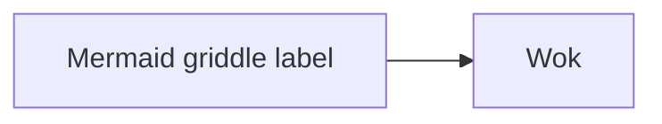

A paragraph with a griddle (line 9).

:::tabs
### The griddle tab

Tab body with a griddle (line 15).

### Second tab

No bad word here.
:::

:::accordion
### Accordion griddle title

Accordion body with a griddle (line 25).
:::

:::human
A human-only segment with a griddle (line 29).
:::

:::llm
An LLM text with a griddle (line 33).
:::

```terminal title="Terminal griddle title" id=griddle
@step Terminal step griddle
$ echo griddle
griddle
```

```filetree
@step Tree step griddle
src/
  griddle.go  # a note with a griddle
```

```chart
kind: bar
title: Chart griddle title
x: { label: dish, values: [griddle, wok] }
y: { label: count }
series:
  - name: Series griddle name
    data: [3, 4]
```



```animation
pill a "Animation griddle label"
pill b "Wok"
a -> b "link"
@step Animation griddle caption
send "go" a -> b
@step Second caption, no bad word
note b: a note with a griddle
```

```tierlist title="Tier griddle title"
S: Wok
A: Tier griddle item
```

```alignment title="Which pan?"
x: low effort .. high effort
y: high impact .. low impact
low effort / high impact "Cell griddle label": Wok
```
