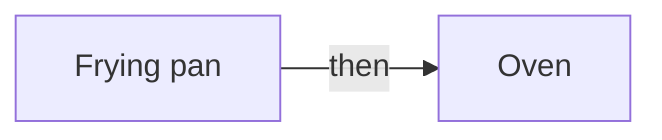

A **Frying pan** sits on the hob. Use the `griddle` flag of the tool, never the word itself in prose.
A Fry pan is the same thing. [A pan guide](griddle.md) is a link, and its target is not read.

```sh
# fenced code is never read: griddle, skillet, oven
echo skillet
```

    indented code is never read either: skillet

| Tool | Heat |
| --- | --- |
| Frying pan | high |
| Oven | dry |

> A conflict resolver settles two recipes. Several conflict resolvers can take part.


